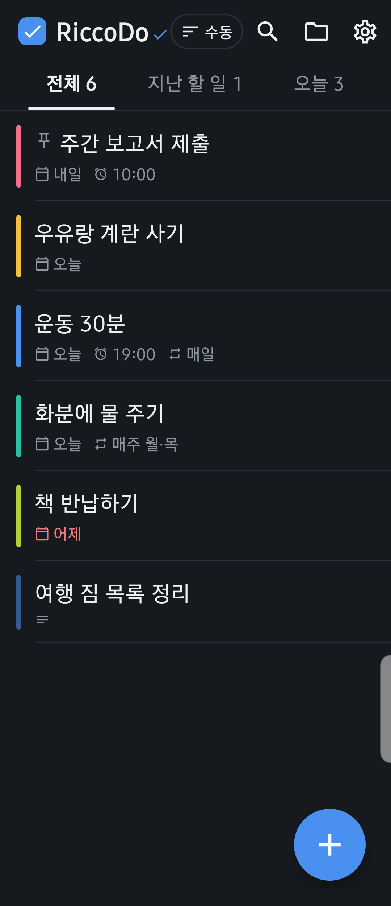
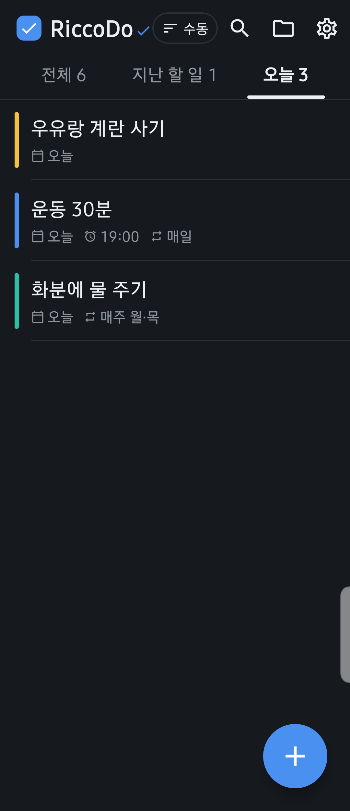
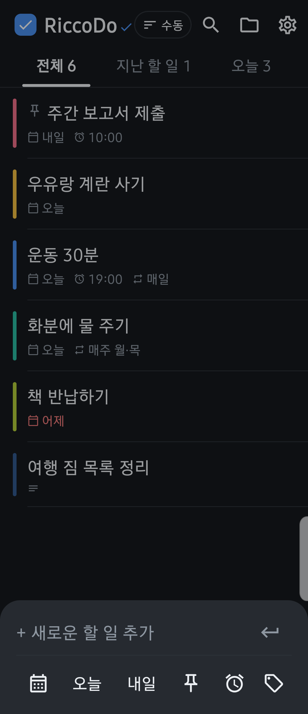
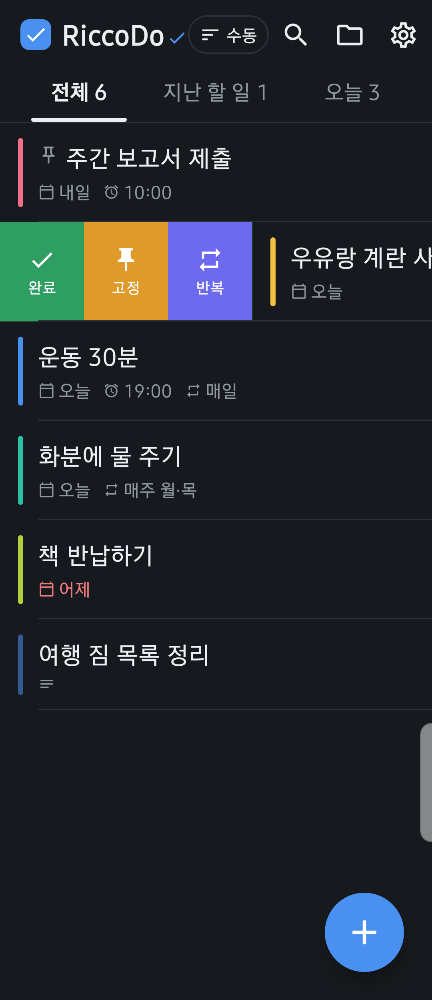
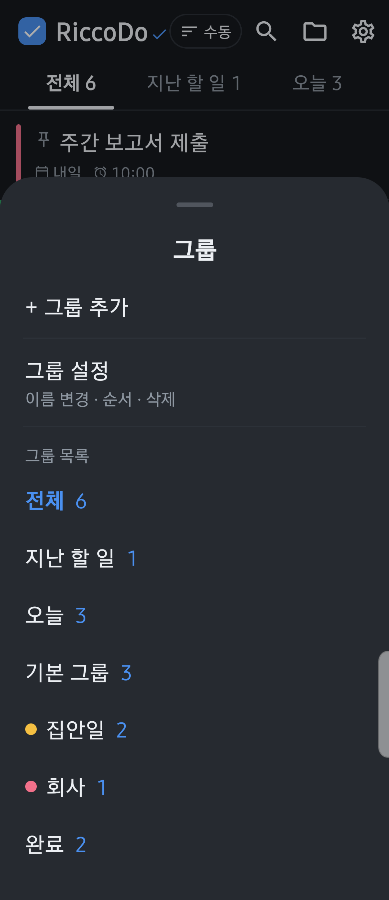
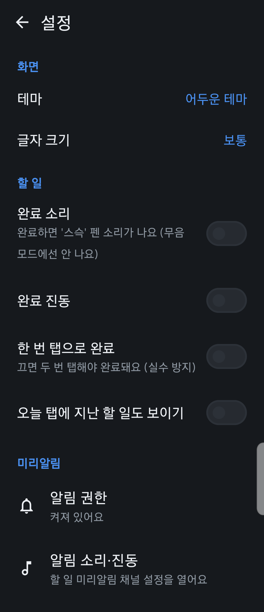
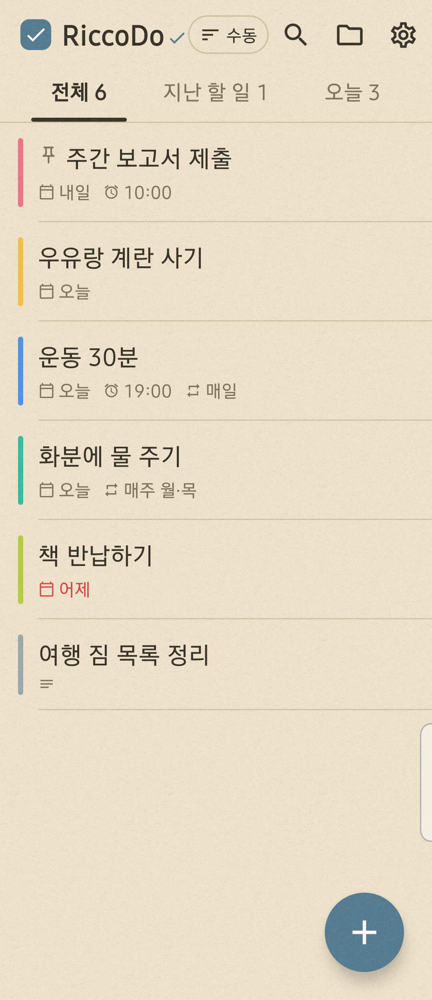

# RiccoDo

**미리알림이 있는 간단한 할 일 목록 Android 앱**

오늘 할 일을 가볍게 정리하고, 중요한 시간은 놓치지 마세요.
광고 없음 · 회원가입 없음 · 인앱결제 없음 · 내 Google 드라이브에 자동 백업.

  
  
  

  
  
  

*화면은 예시 데이터로 촬영했습니다.*

## 다운로드

**[최신 버전 APK 받기 (Releases)](https://github.com/pjh3152/RiccoDo-app/releases/latest)**

`Assets` 항목의 **RiccoDo-1.2.0.apk**를 받아 설치하면 됩니다.

- 지원 기기: **Android 8.0 (Oreo) 이상**
- 처음 설치할 때 브라우저나 파일 앱의 ‘출처를 알 수 없는 앱 설치’를 허용해야 할 수 있습니다.
- 새 버전은 덮어 설치하면 할 일과 설정이 유지됩니다. 앱을 지우고 설치하면 데이터도 지워집니다.
- 미리알림을 사용하려면 알림 권한을 허용해 주세요. 알림이 늦으면 설정의 배터리 최적화 안내도 확인해 주세요.

## 주요 기능

### 할 일을 한눈에

- **전체 / 지난 할 일 / 오늘** 탭과 남은 개수
- 할 일 왼쪽의 세로 색줄, **15가지 색 태그**, 맨 위 고정
- 제목·메모 검색, 완료된 할 일도 함께 검색
- 그룹별 정리, 그룹 이름·색·순서 변경
- 정렬 6가지: 수동·예정일·입력 시간·수정 시간·가나다·색 태그
- 수동 정렬에서 길게 눌러 끌어 순서 변경

### 빠르게 적고, 기분 좋게 완료

- **+ 버튼**에서 오늘·내일·달력 날짜, 알림, 고정, 색 지정
- 엔터로 저장한 뒤 다음 할 일을 연속 입력
- 두 번 탭하면 체크 애니메이션과 ‘스슥’ 펜 소리로 완료, **되돌리기** 지원
- 오른쪽으로 밀기: 완료·고정·반복
- 왼쪽으로 밀기: 수정·그룹 이동·삭제
- 설정에서 한 번 탭 완료, 소리·진동 켜기/끄기 선택

### 미리알림과 반복

- 정한 시각에 알림, 알림에서 **완료 / 10분 뒤 / 1시간 뒤** 처리
- 알림을 누르면 해당 할 일로 이동
- 폰 재부팅·앱 업데이트 후 남은 알림 다시 예약
- 매일·평일·매주(요일 선택)·매월·N개월마다·매년 반복
- 반복 할 일을 완료하면 다음 회차를 만들고 알림도 예약

### 오래 쓰기 위한 기능

- 홈 화면 **오늘 할 일 위젯**: 완료·빠른 추가, 그룹·배경 진하기 선택
- 완료 목록과 되돌리기, 휴지통의 복원·영구 삭제
- 휴지통은 30일 보관 후 앱 실행 시 정리
- **Google 드라이브 백업**: 지금 백업, 매일·매주 자동 백업, 드라이브 목록에서 골라 복원
- **JSON 백업 파일 내보내기·복원**, 복원 전 자동 백업
- 앱 실행 시 하루 한 번 내부 자동 백업, 최근 7개 보관
- 어두운 / 밝은 / **종이 테마** / 시스템 테마와 글자 크기 조절

### 종이 수첩 같은 화면

따뜻한 미색과 은은한 알갱이·섬유결이 있는 **종이 테마**도 선택할 수 있습니다.

## 데이터와 백업

할 일과 설정은 **내 폰 안에** 저장합니다. 개인정보를 수집하지 않고, 개발자 서버로 보내지 않습니다.

### ☁️ Google 드라이브 백업

설정 → **Google 드라이브 백업**에서 내 Google 계정을 연결하면, 할 일을 **내 드라이브**에 백업하고 복원할 수 있습니다.

- **지금 백업** 한 번 누르기, 또는 **자동 백업**(매일·매주, Wi-Fi 에서만 선택)
- 보관 개수(기본 10개)를 넘는 오래된 백업은 자동 정리
- 드라이브의 백업 목록에서 골라 **복원** — 폰을 바꿔도 같은 계정으로 연결하면 그대로 가져올 수 있습니다
- 드라이브 안의 **앱 전용 숨김 폴더**만 사용합니다. 사진·문서 같은 다른 드라이브 파일은 보지 않으며, 개발자도 백업을 볼 수 없습니다
- 자동 백업은 Android가 배터리·네트워크 상황을 보고 실행하므로 정확한 시각은 보장되지 않습니다

### 📁 백업 파일 내보내기

앱 안 자동 백업은 앱을 지우면 함께 지워집니다. 드라이브 백업을 쓰지 않는다면 폰을 바꾸거나 앱을 삭제하기 전에 설정 → 데이터 관리 → **백업 파일 내보내기**로 별도 보관해 주세요. 복원은 현재 데이터를 백업 내용으로 바꾸므로 확인 창의 날짜와 개수를 확인하세요.

시스템 파일 선택기에서 클라우드 저장 위치를 직접 고른 경우, 그 파일의 보관·전송은 해당 저장 서비스가 처리합니다.

## 권한 안내

| 권한 | 쓰는 곳 |
|---|---|
| 알림 (`POST_NOTIFICATIONS`) | 미리알림 표시 (Android 13 이상) |
| 정확한 알람 (`USE_EXACT_ALARM` / `SCHEDULE_EXACT_ALARM`) | 정한 시각에 알림 예약. `SCHEDULE_EXACT_ALARM`은 Android 12L 이하에 선언 |
| 부팅 완료 수신 (`RECEIVE_BOOT_COMPLETED`) | 폰을 다시 켠 뒤 남은 알림 다시 예약 |
| 진동 (`VIBRATE`) | 완료 시 짧은 진동과 미리알림 진동 |
| 인터넷, 네트워크 상태 (`INTERNET` / `ACCESS_NETWORK_STATE`) | Google 드라이브 백업·복원 (연결한 경우에만), 자동 백업의 Wi-Fi 전용 판단 |

드라이브를 연결하지 않으면 인터넷을 쓰지 않습니다. 자세한 내용은 [개인정보처리방침](https://pjh3152.github.io/RiccoDo-app/privacy.html)을 확인하세요.

## 버전 기록

### v1.2.0 (2026-11-19)

- 반복에 ‘N개월마다’ 추가: 매월을 고른 뒤 −/+ 버튼으로 2~24개월 간격 선택 (예: 2개월마다, 6개월마다)

### v1.1.1 (2026-11-19)

- 설정의 하위 화면(드라이브 백업 등)에 들어갔다 돌아와도 설정 화면 스크롤 위치 유지
- 할 일 수정 화면에 다녀와도 목록 스크롤 위치 유지

### v1.1.0 (2026-11-19)

- **Google 드라이브 백업** 추가: 지금 백업, 매일·매주 자동 백업, 드라이브에서 복원, 보관 개수 설정
- 설정 하위 화면에서도 완료·복원 안내 메시지가 보이도록 수정

### v1.0.2 (2026-11-19)

- 첫 공개 버전
- 할 일·미리알림·반복·그룹·위젯·백업·복원 제공
- 펜 효과음, 세로 색줄, 종이 테마 제공
- 수동 드래그 정렬 동작 개선

## 개인정보처리방침

[개인정보처리방침 보기](https://pjh3152.github.io/RiccoDo-app/privacy.html)

## 문의 / 버그 제보

[GitHub Issues](https://github.com/pjh3152/RiccoDo-app/issues)에 남겨 주세요. 공개 글에 실제 할 일이나 개인정보가 담기지 않도록 확인해 주세요.
